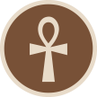
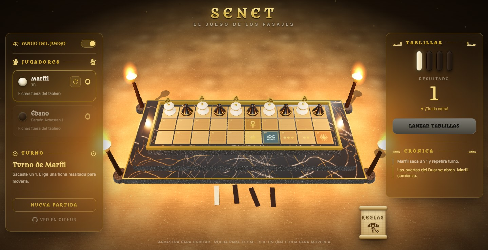

<div align="center">

#  SENET · El Juego de los Pasajes

**Una recreación interactiva en 3D del antiguo juego de mesa egipcio, ambientada en el viaje del alma a través del Duat.**

<br />

[](https://elfaoscura.github.io/Senet/)

[](https://threejs.org/)
[](https://tailwindcss.com/)
[](https://greensock.com/gsap/)
[](https://vitejs.dev/)

<br />



</div>

---

## 🏺 Sobre el proyecto

**Senet** es uno de los juegos de mesa más antiguos que se conocen: se jugaba en el Antiguo Egipto hace más de 5000 años y representaba el viaje del alma hacia la vida eterna. En esta versión te enfrentas al **Faraón Arhestan I**, un bot con personalidad que celebra sus ventajas y se burla de tus errores, sobre un tablero de granito, mármol y oro iluminado por antorchas.

Todo el escenario, las texturas y los efectos de sonido se generan en el propio navegador: **no hay modelos 3D, imágenes ni archivos de audio pesados**. La única excepción son las voces del Faraón, que son opcionales (consulta la sección [Voces del Faraón](#-voces-del-faraón)).

---

## ✨ Características

* **Escenario 3D procedural (Three.js):** tablero de granito negro pulido, mármol veteado, arena del desierto con relieve y antorchas con luz parpadeante.
* **Tablillas 3D con física:** las cuatro tablillas se lanzan sobre la arena, rebotan y muestran el resultado de la tirada.
* **Personalización de fichas:** cambia en tiempo real el diseño de las fichas de Marfil entre *Carrete Clásico*, *Cilindro Anillado* y *Cono Faraónico* (`LatheGeometry`, con detalles en oro).
* **Motor de audio procedural (Web Audio API):** impactos de madera, fichas que caen en cascada, chapoteos y acordes en escala Hijaz, todo sintetizado en tiempo real con reverberación de sala de templo.
* **Bot con personalidad:** el Faraón Arhestan I juega con una heurística propia y comenta la partida con 20 frases según vaya ganando o perdiendo.
* **Voces opcionales:** cada frase del Faraón puede reproducir su propio archivo de audio al mismo tiempo que aparece el texto.
* **Interfaz adaptativa (glassmorphism):**
  * **Escritorio:** paneles laterales con jugadores y turno, tablillas, crónica de la partida, papiro de reglas e indicadores jeroglíficos (`𓂻`) sobre las fichas jugables.
  * **Móvil:** HUD propio con barra superior de jugadores y puntuación, tablillas y resultado en la esquina, frases del Faraón arriba al centro y barra inferior flotante con sonido, diseño de ficha, lanzar tablillas y nueva partida.
* **Tooltips informativos:** detalles contextuales al pasar el cursor sobre las casillas sagradas.
* **Sonido con interruptor:** recuerda tu preferencia de audio entre sesiones.

---

## 🎮 Cómo se juega

### Controles

| Acción | Escritorio | Móvil |
| --- | --- | --- |
| Girar la cámara | Arrastrar con el ratón | Arrastrar con un dedo |
| Zoom | Rueda del ratón | Pellizcar |
| Mover una ficha | Clic en una ficha resaltada | Toque en una ficha resaltada |
| Ver info de una casilla sagrada | Pasar el cursor | — |

### Reglas rápidas

1. **Objetivo:** sé el primero en sacar tus **5 fichas** del tablero recorriendo las 30 casillas en forma de serpiente.
2. **Las tablillas:** lanza 4 tablillas de doble cara. Las caras claras indican el avance (`1`, `2`, `3` o `4`), y si todas caen oscuras, avanzas `5`. Sacar `1`, `4` o `5` otorga **tirada extra**.
3. **Intercambios:** si caes sobre una ficha rival aislada, intercambian posiciones.
4. **Protección y bloqueos:** dos fichas del mismo color juntas están protegidas; tres o más seguidas forman un bloqueo que no se puede saltar.
5. **Casillas sagradas:** las fichas en las casillas 26, 28, 29 y 30 no pueden ser desplazadas.
6. **Sin movimientos:** si no tienes ninguna jugada legal, pierdes el turno.

### Casillas especiales

| Casilla | Nombre | Efecto |
| :---: | --- | --- |
| 15 | Casa del Renacimiento ☥ | A ella vuelven las fichas que caen en las aguas. |
| 26 | Casa de la Felicidad | Parada obligatoria. Se sale con un `5` exacto. |
| 27 | Casa de las Aguas | Trampa: devuelve la ficha a la casilla 15 (o a la primera libre anterior). |
| 28 | Casa de las Tres Verdades | Casilla segura. Se sale con un `3` exacto. |
| 29 | Casa de Re-Atum | Casilla segura. Se sale con un `2` exacto. |
| 30 | Casa de Horus | Casilla segura. Se sale con un `1` exacto. |

> 💡 *Las reglas originales del Senet se perdieron con el tiempo. Esta versión sigue la reconstrucción más aceptada por los egiptólogos modernos.*

---

## 🚀 Instalación y uso local

Necesitas [Node.js](https://nodejs.org/) 18 o superior.

```bash
# 1. Clona el repositorio
git clone [https://github.com/ElfaOscura/Senet.git](https://github.com/ElfaOscura/Senet.git)
cd Senet

# 2. Instala las dependencias
npm install

# 3. Inicia el servidor de desarrollo
npm run dev

# 4. Compila para producción (genera la carpeta dist/)
npm run build

# 5. (Opcional) Previsualiza la versión compilada
npm run preview